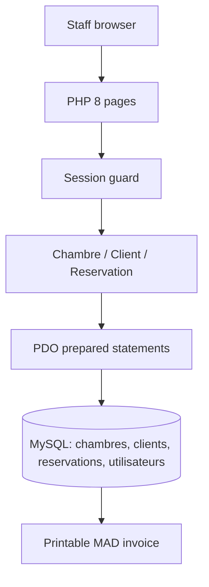

# 🏨 Guest House & Hotel Management — SARL HIND ET PIERRE

[-10b981?style=for-the-badge)](https://github.com/0dh4m)
[](https://php.net/)
[](https://mysql.com/)
[-d97706?style=for-the-badge)](https://github.com/0dh4m)
[](LICENSE)

> **Internship project built for the hospitality establishment SARL HIND ET PIERRE in Rabat, Morocco.**
> A PHP 8 + MySQL back-office for room inventory, guest records, reservations and printable invoices.

[Features](#-features) • [Architecture](#-architecture) • [Setup](#-setup) • [Security](#-security-notes) • [License](#-license)

---

## 🎯 Scope

This is an internal staff dashboard, not a full hotel ERP. It covers:

- Room inventory and availability status
- Guest records (CIN / passport, phone, email)
- Reservations with overlap detection
- Check-out and reservation status updates
- Printable invoices in MAD

It does **not** include online booking, channel managers, POS, accounting exports, housekeeping schedules, ID scanning or a guest self-service portal.

---

## ✨ Features

### 📊 Dashboard (`index.php`)
- Counts for rooms, guests and reservations.
- Revenue total from completed reservations.
- Today's departures with a one-click **“Libérer la chambre”** check-out action.
- Five most recently added guests.

### 🛏️ Room inventory (`Chambre.php`, `pages/chambres.php`)
- Create and edit rooms with number, type, nightly rate (MAD) and status.
- Status filters: `Disponible`, `Occupée`, `En nettoyage`.
- Per-room nightly pricing used by the reservation and invoice logic.

### 👤 Guest records (`Client.php`, `pages/clients.php`)
- Add and edit guests: full name, CIN or passport, phone, email.
- Search by name or CIN.

### 📅 Reservations (`Reservation.php`, `pages/reservations.php`)
- Create a reservation from an existing guest and room, with arrival/departure dates.
- **Overlap detection:** a room cannot be double-booked for intersecting dates while a reservation is active.
- Insert + room-status update run inside a **PDO transaction** with rollback on failure.
- Status updates for confirmed, cancelled and completed reservations.
- Separate lists for confirmed and completed stays.

### 🧾 Invoices (`pages/facture.php`)
- Printable invoice for a reservation.
- Line total = nights × nightly rate, with a final total in MAD.
- Print-friendly layout via the browser print dialog.

### 🔐 Authentication (`login.php`, `logout.php`)
- Session-based staff login.
- Passwords stored with `password_hash()` and checked with `password_verify()`.
- Login is required for every dashboard and page.

---

## 🛠️ Architecture



- **Backend:** PHP 8 (OOP, PDO prepared statements, sessions).
- **Database:** MySQL / MariaDB with primary keys and foreign keys from `reservations` to `clients` and `chambres`.
- **Frontend:** Bootstrap 5.3, Font Awesome 6, server-rendered PHP.
- **No framework, no build step.**

---

## 📂 Project Structure

```text
hotel-management-system/
├── Database.php              # PDO connection (env-driven)
├── Chambre.php               # Room entity and CRUD
├── Client.php                # Guest entity and CRUD
├── Reservation.php           # Reservation creation, overlap check, status updates
├── index.php                 # Dashboard and check-out action
├── login.php / logout.php    # Staff authentication
├── database_schema.sql       # Tables, keys, seed rooms/guests and admin user
├── images/                   # Brand assets
├── pages/
│   ├── chambres.php          # Room inventory UI
│   ├── clients.php           # Guest registry and search
│   ├── reservations.php      # Booking form and reservation lists
│   └── facture.php           # Printable invoice
└── scripts/
    └── set_admin_password.php # Rotate the admin password
```

---

## 🚀 Setup

### Prerequisites
- PHP **8.1+** with `pdo_mysql`
- MySQL 8 / MariaDB
- Apache/Nginx, or the PHP built-in server

### 1. Create and import the database

```sql
CREATE DATABASE gestion_hotel CHARACTER SET utf8mb4 COLLATE utf8mb4_unicode_ci;
```

```bash
mysql -u root -p gestion_hotel < database_schema.sql
```

The schema creates `chambres`, `clients`, `reservations` and `utilisateurs`, with foreign keys and demo rows.

### 2. Configure the connection

`Database.php` reads environment variables and falls back to local XAMPP defaults:

```text
HOTEL_DB_HOST=localhost
HOTEL_DB_PORT=3306
HOTEL_DB_NAME=gestion_hotel
HOTEL_DB_USER=root
HOTEL_DB_PASS=
```

Set them in your shell, Apache `SetEnv`, or your local server config. Do not commit real credentials.

### 3. Run the app

```bash
php -S localhost:8000
```

Open **http://localhost:8000/login.php**.

### 4. Default login

| Username | Password |
|---|---|
| `admin` | `admin123` |

Change it immediately:

```bash
php scripts/set_admin_password.php "a-strong-new-password"
```

The script hashes the password with `PASSWORD_DEFAULT` and updates the `admin` row.

---

## 🔐 Security Notes

- Login uses `password_verify()` only; there is no hard-coded password bypass.
- All database access uses PDO prepared statements.
- Reservation writes are transactional and reject date overlaps.
- `Database.php` no longer contains credentials; use environment variables.
- The seed password is for local demos only. Rotate it before deploying.
- Add HTTPS and restrict access to the staff network before using this with real guest data.

---

## 👨‍💻 Author

**Adham Cherkaoui Eddeqaqi (0dh4m)**
- 🐙 GitHub: [@0dh4m](https://github.com/0dh4m)
- 🌐 Portfolio: [0dh4m.github.io](https://0dh4m.github.io/)
- ✉️ Email: [0dh4mm@gmail.com](mailto:0dh4mm@gmail.com)
- 📍 Rabat / Salé, Morocco

---

## 📄 License

Proprietary and confidential — see [LICENSE](LICENSE). Unauthorized copying or distribution is prohibited.

*Copyright © 2026 Adham Cherkaoui Eddeqaqi (0dh4m). All rights reserved.*
