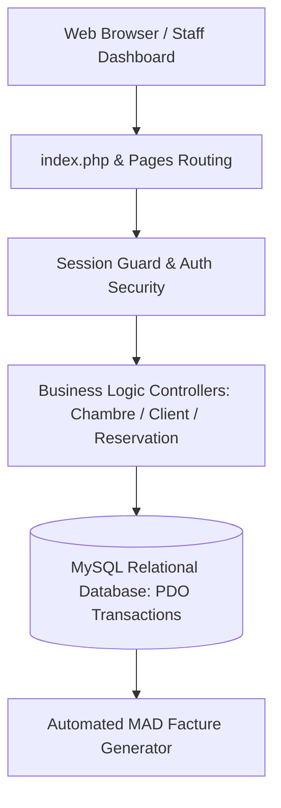

# 🏨 Guest House & Hotel Management ERP — SARL HIND ET PIERRE

[-10b981?style=for-the-badge)](https://github.com/0dh4m)
[](https://php.net/)
[](https://mysql.com/)
[-d97706?style=for-the-badge)](https://github.com/0dh4m)
[](LICENSE)

> **Commercial Internship Software Solution** engineered and deployed by **Adham Cherkaoui Eddeqaqi (`0dh4m`)** for the hospitality establishment **SARL HIND ET PIERRE** in Rabat, Morocco.

---

## 🌟 Executive Overview & Key Modules

A comprehensive, robust management platform engineered to automate full hotel and riad hospitality operations:

1. **Room Inventory & Real-Time Availability Matrix (`Chambre.php`, `pages/chambres.php`):**
   - Categorized room management: *Suites Royales, Chambres Deluxe, Chambres Traditionnelles*.
   - Live status workflow: `Disponible` (Available), `Occupée` (Occupied), `En Nettoyage` (Housekeeping), `Maintenance`.
   - Dynamic price rate per night in Moroccan Dirham (MAD).

2. **Client Relationship Management (`Client.php`, `pages/clients.php`):**
   - Secure guest identity records with Moroccan National Identity Card (CIN) / International Passport tracking.
   - Comprehensive contact book, reservation history, and VIP preference logs.

3. **Booking & Reservation Scheduling (`Reservation.php`, `pages/reservations.php`):**
   - Check-in & check-out scheduling with automatic conflict avoidance.
   - Atomic multi-table PDO transaction handling (updating reservation state + toggling room availability in one safe transaction).
   - Rollback safeguards protecting data integrity during concurrency.

4. **Automated Moroccan Dirham (MAD) Invoicing (`pages/facture.php`):**
   - Automated invoice calculation taking into account number of nights, room rates, VAT (TVA), and local tourist tax (*Taxe de séjour*).
   - Clean printable/exportable layout conforming to Moroccan fiscal standards.

---

## 🛠️ Architecture & Tech Stack



- **Backend:** PHP 8 (OOP, PDO Prepared Statements, Session Security).
- **Database:** MySQL 3NF relational schema with foreign key constraints and transactional integrity.
- **Frontend:** Responsive modern interface, Bootstrap, Font Awesome icons.
- **Security:** SQL injection prevention via prepared PDO queries, XSS sanitization, transaction rollbacks.

---

## 📂 Project Directory Structure

```
├── Database.php              # Secure PDO Database Connection singleton
├── Chambre.php               # Room entity & operational business logic
├── Client.php                # Client entity & CRM operations
├── Reservation.php           # Reservation scheduling & transaction management
├── index.php                 # Central administrative dashboard & check-out controller
├── login.php                 # Authenticated employee / manager access
├── logout.php                # Secure session termination
├── database_schema.sql       # Full relational 3NF database schema & seed data
├── images/                   # Brand assets and hotel media
└── pages/
    ├── chambres.php          # Room inventory management UI
    ├── clients.php           # Guest registry & search
    ├── reservations.php      # New booking & schedule tracking
    └── facture.php           # Official printable hospitality invoice
```

---

## 🚀 Installation & Local Deployment

### Prerequisites
- PHP 8.0+
- MySQL / MariaDB Server (e.g., via XAMPP, Laragon, or Docker)
- Apache / Nginx web server

### Setup Steps
1. **Clone the repository:**
   ```bash
   git clone https://github.com/0dh4m/hotel-management-system.git
   cd hotel-management-system
   ```

2. **Import the Database:**
   - Create a database named `gestion_hotel` in MySQL:
     ```sql
     CREATE DATABASE gestion_hotel CHARACTER SET utf8mb4 COLLATE utf8mb4_unicode_ci;
     ```
   - Import `database_schema.sql` into `gestion_hotel`.

3. **Configure Database Credentials:**
   - In `Database.php`, verify your host, database name, username, and password.

4. **Run the Application:**
   - Start your Apache server or run PHP built-in server:
     ```bash
     php -S localhost:8000
     ```
   - Navigate to `http://localhost:8000/login.php`.

---

## 👨‍💻 Author & Contact

**Adham Cherkaoui Eddeqaqi (0dh4m)**  
- **GitHub:** [@0dh4m](https://github.com/0dh4m)  
- **Portfolio:** [0dh4m.github.io/portfolio](https://0dh4m.github.io/portfolio/)  
- **Email:** [0dh4mm@gmail.com](mailto:0dh4mm@gmail.com)  
- **Location:** Rabat / Salé, Morocco
